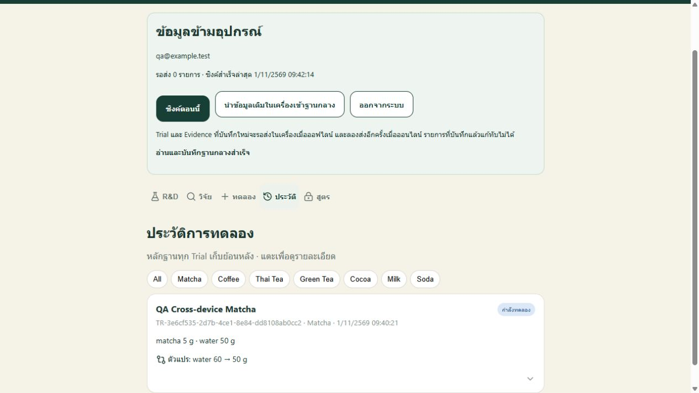

# Phase 1 verification — 2026-11-01

Base: `9655591de004944e053ce72e06cd1ca2892f5caa`.

- 51 automated tests passed, including PostgreSQL-compatible PGlite execution of the actual migration: anonymous denial, signed-in account isolation, denied direct insert/update/delete, idempotent replay, whole-batch rollback on conflicts, duplicate batch rejection, server LOCK requirements and strict boolean gates.
- Client tests passed for offline/response-loss replay, fresh-device read, concurrent local save during a network request, corrupt/unavailable storage, cross-account cache denial, quota failure, missing acknowledgment and missing server history.
- Production Vite build passed. Lucide emitted its module-level `use client` bundling warning; no build error.
- UI checked against an in-memory synthetic QA API, using separate browser origins `127.0.0.1:5190` and `127.0.0.1:5191` so their device caches were independent. A synthetic Trial created on the first origin appeared with the same ID and content on the second after sign-in/sync. No seeded baseline records were uploaded. Sign-out hid the Trial history and required sign-in again.
- At a 390px viewport, no horizontal overflow was observed; cloud action buttons were at least 48px tall. Mobile action buttons were subsequently arranged vertically for clearer wrapping. This is a responsive viewport check, not physical Android/tablet acceptance.

## Not yet verified

Authorized hosted Supabase migration, real Supabase Auth, hosting configuration/deployment, real owner-data import and physical PC/Android/tablet acceptance have **not** been performed. Local QA's synthetic login is not evidence of hosted authentication security. Ingredient Master, separate staff roles and approval events remain later issue #8 work. Do not close issue #8 or claim production cross-device synchronization complete on this evidence.
