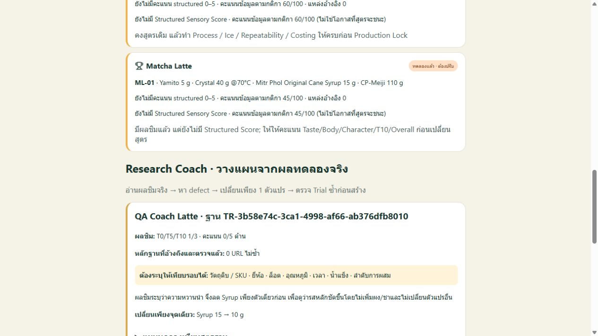

# Research Coach v1 — evidence and evaluation

## Delivered behavior

Research Coach is a deterministic, inspectable decision layer over the existing R&D engine, not a new trained foundation model. It reads only the currently available Trial/Evidence records. It cannot access private experiments on another device before those records are imported/synchronized, and it does not claim to have collected every source on the internet.

The dashboard now shows measured T0/T5/T10 coverage, structured-score coverage, missing process controls, linked-evidence audit, a checked one-variable change and a baseline-versus-candidate experiment procedure. A candidate remains PLANNED, with prior sensory scores/results and readiness flags cleared. A versioned researchPlan snapshot containing method citations, accepted Trial evidence, gaps, steps and limitations travels with the candidate when the operator explicitly saves it; backups and immutable cloud synchronization preserve that payload.

Evidence must be explicitly linked to the Trial, marked verified by the operator, match the menu, and have a usable HTTPS URL, title and recorded finding. Tracking/fragment variations of the same URL count once. Duplicate source IDs, missing sources, unchecked sources, other-menu sources and incomplete citations are reported, not silently treated as verified support. The audit checks recorded provenance; it does not independently establish the truth or applicability of an operator's finding. Provider-domain detection rejects lookalike hostnames. Merely being hosted at a DOI or publisher URL does not prove peer review.

Negated/ambiguous sensory wording asks for clarification; status/notes without actual sensory observations cannot choose a formula. A high score alone no longer causes a change to whichever dimension happens to be lowest. The `<3/5` fallback trigger is a configurable application heuristic, not a validated sensory-science threshold. Formula comparison verifies exact text and one amount edit, including unchanged units, ingredient names, temperature/process suffixes and every parsed segment. Unparsed or ambiguous formulas are blocked rather than partially edited.

Existing completeness/confidence heuristics are now labelled as a rule-based data score, not a winning probability. No significance, effect size, independent replicate count or actual production approval is fabricated.

## Primary sources inspected 2026-11-01

1. [NIST: One variable at a time](https://www.itl.nist.gov/div898/handbook/pri/section2/pri212.htm). One-factor experiments do not reveal interactions. FIELD keeps the approved one-variable workflow while explicitly displaying that limitation; it does not claim a global optimum.
2. [NIST: Randomized block designs](https://www.itl.nist.gov/div898/handbook/pri/section3/pri332.htm). Identify and control nuisance factors such as operator and run conditions; randomize where appropriate. The beverage procedure is FIELD's application of that method, not a validated NIST beverage recipe or power calculation.
3. [Murakami, Sensory Evaluation of Matcha, Tea Research Journal, 2022, 134:31–38](https://www.jstage.jst.go.jp/article/cha/2022/134/2022_31/_article/-char/en). The abstract describes appearance, particle fineness, foaming and taste evaluation. Its assessment preparation is not imported as a FIELD serving formula. Only the abstract was reviewed in this implementation; no claim of a full-paper review is made.

These methods are displayed separately from operator-verified Evidence and do not auto-verify a recipe, determine the winning drink, or make nutritional/health claims.

## Test evidence

14 new coach regression tests cover measured-data requirements, single-variable tracing, Thai/English negation, high-score no-change, immutable locks, exact formula deltas, ambiguous parsing, duplicate candidates, linked-source/URL/ID audit, unlinked adversarial instructions, domain spoofing and honest coverage. Together with the existing tests, the local suite contains 71 passing tests. Production Vite build passes with the existing Lucide bundling warning.

Synthetic browser QA checks ML-01/ML-02 duplicate suppression, visible missing lot/process controls, method links/limitations and generation of a QA candidate with Syrup 15→10 g only. The prepared candidate is PLANNED with T0/T5/T10 and scores blank, and its source Trial remains unchanged. No real FIELD tasting, hosted DB migration or physical-device acceptance was performed in this work.

## Comparison boundary

The reproducible [authored regression comparison](research-coach-benchmark.json), generated with `node scripts/evaluate-coach.mjs`, compares the previous FIELD code at `0fe259962cc5c0cd21d0940821d0829f325f14b6` with this coach on ten selected cases. The previous code passes 3/10 and the coach passes 10/10. The set deliberately includes the defects being fixed (negation, notes-only data, high-score changes, unknown states, partial parsing and domain lookalikes), along with positive, duplicate and lock cases. It is a targeted regression demonstration, not an unbiased general-accuracy estimate.

This regression suite measures the defined FIELD behaviors only. It is not a blind or held-out comparison with Claude, ChatGPT or any other model. No superiority claim is supported. A later comparison needs the same frozen input set, independent expert scoring and actual tasting outcomes; passing these authored tests is insufficient evidence of better scientific judgment.
